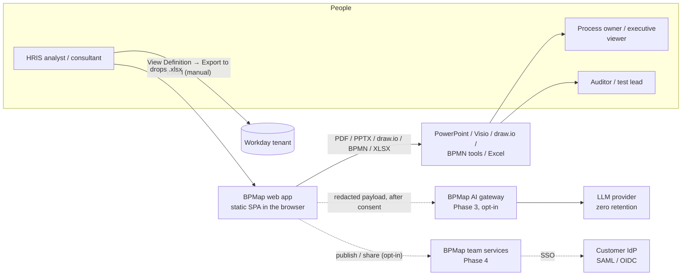
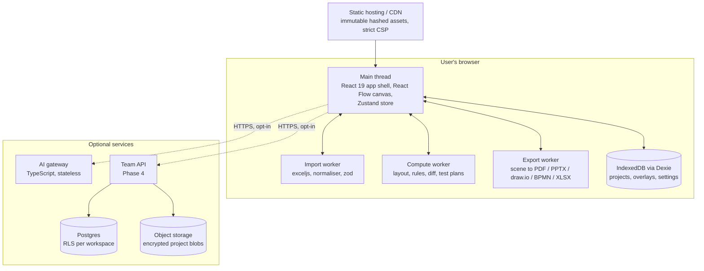
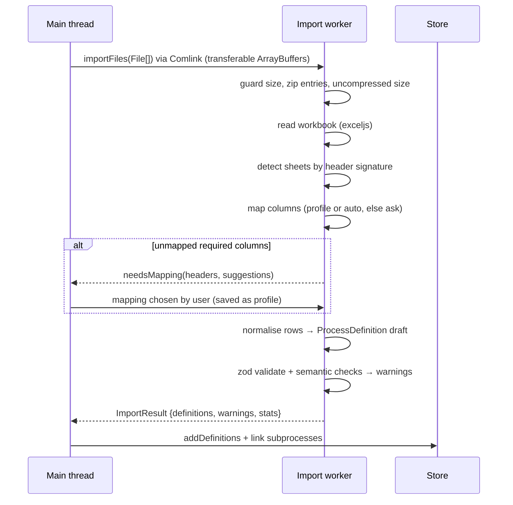
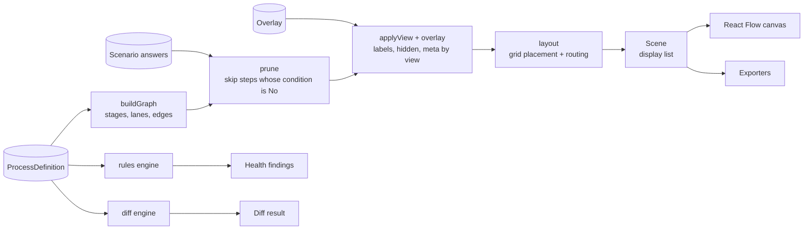
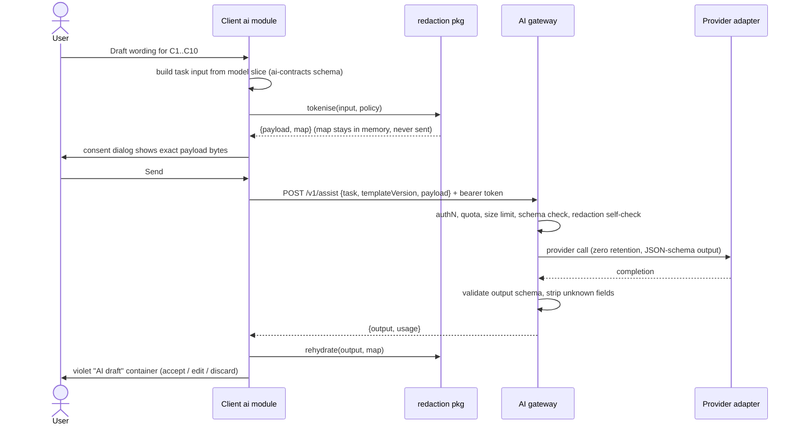
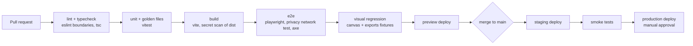

# BPMap Architecture

**Version** 1.0 (Draft) · **Date** 10 November 2026 · **Owner** Rishabh · **Status** Proposed; decisions marked *Spike* need validation in Phase 1
**Companion docs** [PRD](PRD_BPMap_for_Workday.md) · [Design System](DESIGN_SYSTEM.md) · [Scale-up plan](../SCALE_UP_PLAN.md)

---

## Contents

1. [Goals & quality attributes](#1-goals--quality-attributes)
2. [Architecture principles](#2-architecture-principles)
3. [System context](#3-system-context)
4. [Containers & deployment units](#4-containers--deployment-units)
5. [Repository & module structure](#5-repository--module-structure)
6. [Canonical model](#6-canonical-model)
7. [Import pipeline](#7-import-pipeline)
8. [From model to screen: the derivation pipeline](#8-from-model-to-screen-the-derivation-pipeline)
9. [Layout engine](#9-layout-engine)
10. [Scenario engine & test-plan generator](#10-scenario-engine--test-plan-generator)
11. [Rules engine (Health & Controls)](#11-rules-engine-health--controls)
12. [Diff engine (Compare)](#12-diff-engine-compare)
13. [Overlays](#13-overlays)
14. [Application state & persistence](#14-application-state--persistence)
15. [Rendering (canvas)](#15-rendering-canvas)
16. [Export pipeline](#16-export-pipeline)
17. [AI Assist architecture](#17-ai-assist-architecture)
18. [Security architecture](#18-security-architecture)
19. [Team & Enterprise (Phase 4)](#19-team--enterprise-phase-4)
20. [Build, CI/CD & environments](#20-build-cicd--environments)
21. [Testing strategy](#21-testing-strategy)
22. [Observability](#22-observability)
23. [Performance budgets](#23-performance-budgets)
24. [Migration from the prototype](#24-migration-from-the-prototype)
25. [Architecture decision records](#25-architecture-decision-records)
26. [Open technical questions](#26-open-technical-questions)

---

## 1. Goals & quality attributes

When two attributes conflict, the higher one in this list wins.

| Rank | Attribute | Scenario that proves it |
|---|---|---|
| 1 | **Privacy** | With default settings, importing, editing and exporting a definition produces **zero** network requests that carry file content or derived data (Playwright network capture in CI) |
| 2 | **Correctness** | 100% step fidelity on the golden corpus; Workday semantics (skip-on-false, parallel stages) hold in every view and export |
| 3 | **Determinism** | The same export file always produces the same model, IDs, layout and exports (byte-stable SVG) |
| 4 | **Performance** | A 60-step definition parses and renders in < 2 s P95 on a 2020-era laptop |
| 5 | **Extensibility** | Adding a new step kind, health rule or export format touches one module plus its tests |
| 6 | **Operability** | The free tier needs no backend; Phase 3+ services are small and can be self-hosted |

## 2. Architecture principles

1. **Local-first.** The app is a static single-page app. Parsing, modelling, layout, rules and exports all run in the browser. Servers are **optional add-ons** (AI gateway, team services).
2. **One canonical model.** Every importer produces the same validated `ProcessModel`. Nothing downstream ever reads a spreadsheet row.
3. **Overlays never mutate the model.** User customisations are a separate document keyed by stable IDs.
4. **Derive, don't store.** Layout, health findings, diffs, scenarios and test plans are **pure functions** of (model, overlay, settings). Memoise them; never persist them as truth.
5. **Pure core, thin shell.** The engines (`packages/*`) are framework-free TypeScript with no DOM access. They are trivially testable and reusable in workers and on the server.
6. **Heavy work off the main thread.** XLSX parsing, layout and exports run in Web Workers.
7. **Adapters at the edges.** Importers, exporters and AI providers sit behind interfaces, so a new format is a new adapter.
8. **AI is a plugin, not a dependency.** The product is fully functional with AI disabled. The client never holds model-provider credentials.

---

## 3. System context



The user is the only bridge between Workday and BPMap in Phases 1–3. A tenant connector (RaaS) is a Phase 4 *pilot* (ENT-05), pending a feasibility and security review.

## 4. Containers & deployment units



| Unit | Tech | Phase | Stateful? | Self-hostable |
|---|---|---|---|---|
| Web app | React 19, Vite, TypeScript, React Flow 12, Tailwind 4 | 1 | Browser only | Yes (static files) |
| Import / compute / export workers | TypeScript, Comlink | 1 | No | — |
| AI gateway | TypeScript on Cloudflare Workers **or** a Node container (same code via a small adapter) | 3 | No (metadata logs only) | Yes (container) |
| Team API | TypeScript (Hono or Fastify) + Postgres + S3-compatible storage | 4 | Yes | Yes (Docker Compose / Helm) |

---

## 5. Repository & module structure

The project becomes a **pnpm workspace** in Phase 1. The AI gateway (Phase 3) must reuse `model`, `redaction` and `ai-contracts` without copying them, so it's cheaper to set up the boundaries now than to extract them later (ADR-003).

```
bpmap/
├─ apps/
│  ├─ web/                      # the SPA (evolves from today's src/)
│  │  ├─ src/
│  │  │  ├─ app/                # shell, routing, providers, theme
│  │  │  ├─ features/
│  │  │  │  ├─ import/          # dropzone, parse report, column-mapping dialog
│  │  │  │  ├─ canvas/          # React Flow wrapper, nodes/, edges/, LOD, a11y step list
│  │  │  │  ├─ views/           # executive cards, owner, configurator adapters
│  │  │  │  ├─ panels/          # health, scenario, step, customise
│  │  │  │  ├─ compare/
│  │  │  │  ├─ export/          # UI only; work happens in export worker
│  │  │  │  └─ ai/              # consent dialog, redaction preview, draft containers
│  │  │  ├─ store/              # zustand slices + selectors
│  │  │  ├─ workers/            # import.worker.ts, compute.worker.ts, export.worker.ts
│  │  │  └─ persistence/        # dexie db, migrations, .bpmap io
│  │  └─ e2e/                   # playwright (incl. network-privacy test)
│  ├─ gateway/                  # Phase 3: AI gateway
│  └─ team-api/                 # Phase 4
├─ packages/
│  ├─ model/                    # ProcessModel types, zod schemas, ids, migrations
│  ├─ importer-xlsx/            # sheet detection, column mapping, normalisation
│  ├─ engine-graph/             # stages, lanes, edges (semantic graph)
│  ├─ engine-layout/            # grid placement + edge routing → LayoutResult
│  ├─ engine-scenario/          # evaluation, pruning, pairwise test plans
│  ├─ engine-rules/             # rule registry + HC-01..HC-15
│  ├─ engine-diff/              # alignment + change classification
│  ├─ overlay/                  # overlay schema, merge, orphan detection
│  ├─ scene/                    # render-agnostic display list (shared by canvas + exporters)
│  ├─ exporters/                # svg, pdf, pptx, drawio, bpmn, mermaid, xlsx adapters
│  ├─ redaction/                # tokenise / re-hydrate (shared client + gateway)
│  ├─ ai-contracts/             # request/response zod schemas, prompt template ids
│  ├─ design-tokens/            # tokens.json → css / ts / pptx / drawio
│  └─ fixtures/                 # anonymised golden exports + expected models (snapshots)
└─ tooling/                     # eslint config (import boundaries), tsconfig base, scripts
```

**Dependency rules** (enforced with `eslint-plugin-boundaries`):
- `packages/*` never import from `apps/*`.
- `engine-*` depend only on `model` and `overlay`, plus `scene` for layout.
- Only `apps/web/features/*` touch React.
- Only `exporters` touch PDF/PPTX libraries.
- `redaction` and `ai-contracts` have **no** browser-only or server-only imports.

---

## 6. Canonical model

### 6.1 Types (in `packages/model`)

```ts
export const SCHEMA_VERSION = 1;

export type StepKind =
  | 'initiation' | 'approval' | 'approval-chain' | 'consolidated-approval-chain'
  | 'action' | 'todo' | 'review' | 'checklist' | 'questionnaire'
  | 'integration' | 'service' | 'subprocess' | 'unknown';

export interface ProcessProject {
  schemaVersion: number;
  id: string;                        // uuid
  name: string;
  definitions: ProcessDefinition[];
  createdAt: string; updatedAt: string;
}

export interface ProcessDefinition {
  id: string;                        // slug(process + variant), e.g. "change-job--default-definition"
  process: string;                   // "Change Job"
  variant: string;                   // "Default Definition" | org-specific name
  source: { kind: 'xlsx' | 'ai-vision' | 'bpmap'; fileName?: string; contentHash: string; importedAt: string };
  initiatingGroups: string[];
  steps: Step[];                     // ordered as in the export
  conditions: Condition[];           // C1..Cn, numbered by first appearance
  notifications: Notification[];
  securityPolicy?: SecurityPolicy;   // Phase 3 (IMP-10)
  warnings: ParseWarning[];
}

export interface Step {
  id: StepId;                        // stable — see 6.2
  order: string;                     // raw: "a", "f1", "k"
  stageKey: StageKey;                // normalised sortable key — see 7.4
  kind: StepKind;
  rawType: string;                   // verbatim Workday "Type" value
  task: string;                      // Workday task / "Specify" value
  groups: string[];                  // first = primary lane
  allMustAct: boolean;
  optional: boolean;
  conditionIds: ConditionId[];
  dueDate?: string; dueOnEffectiveDate: boolean;
  alternate?: string; routing?: string; restriction?: string;
  runsAsNamedUser: boolean; doNotAdvance: boolean;
  complete: boolean;                 // process is complete after this step
  subProcessRef?: { process: string; definitionId?: string };
  sourceRow: number;                 // for warnings and parse report links
}

export interface Condition {
  id: ConditionId;                   // "C1"
  text: string;                      // verbatim, "(Workday Owned)" suffix stripped
  workdayOwned: boolean;
  stepIds: StepId[];
  ruleLogic?: string;                // Phase 3 (IMP-09)
}

export interface Notification { id: string; trigger: string; recipients: string[]; isCustom: boolean; stepId?: StepId }
export interface ParseWarning { code: WarningCode; row?: number; message: string; stepId?: StepId }

export type StepId = string & { __brand: 'StepId' };
export type ConditionId = `C${number}`;
export type StageKey = string & { __brand: 'StageKey' };
```

Each interface has a matching **zod schema**. `parseModel(unknown) → Result<ProcessDefinition, ZodError>` is the only way data gets into the store, from every importer, project file and AI output.

### 6.2 Stable step IDs

```
id = `${order}-${kind}-${slug(task || rawType)}`        e.g. "g-action-propose-compensation-change"
on collision within a definition → append `~2`, `~3` in source-row order
```

- **Stable across re-exports.** The ID doesn't depend on row position, so re-ordered rows keep their IDs.
- **Sensitive to meaningful change.** If a step moves to another stage or changes kind, it gets a new ID. The diff engine then reports it as *moved*/*modified* through fuzzy alignment (§12), and the overlay keeps its entries as *orphans* for the user to re-attach (§13).
- `slug` lower-cases the text, folds diacritics, replaces non-alphanumerics with `-`, and truncates to 48 characters.

### 6.3 Schema versioning

`SCHEMA_VERSION` is bumped on any breaking change. `packages/model/migrations/` holds pure functions `vN → vN+1`. The migrations run on project load (IndexedDB and `.bpmap.json`) before validation. Each migration has a fixture test.

---

## 7. Import pipeline

### 7.1 Flow



### 7.2 Hardening limits

| Guard | Limit | On breach |
|---|---|---|
| File size | 25 MB per file, 20 files per import | Reject with message |
| ZIP entries | ≤ 2,000 | Reject (zip-bomb guard) |
| Uncompressed total | ≤ 150 MB | Reject |
| Rows per sheet | ≤ 20,000 | Truncate + warning `W-ROWS-TRUNCATED` |
| Cell text | ≤ 4,000 chars | Truncate + warning |
| Formulas | Ignored (cached values only) | — |
| External links / macros | Never evaluated (`.xlsm` rejected) | — |

### 7.3 Sheet detection & column mapping

Each sheet of a real export has a one-cell **section-title row** ("Business Process Steps", "Notifications", "Allowed Actions by Role", "Allowed Services", "Related Links", "Available Rules & Fields"); the title decides the sheet's role (DEC-028). Within the Steps sheet, the header row is the one that maps ≥ 4 canonical fields. Files without titles fall back to header heuristics. A per-user **mapping profile** (header fingerprint → field map) is stored in IndexedDB.

| Canonical field | Header synonyms (**bold** = confirmed in a real export, DEC-029) | Required |
|---|---|---|
| `order` | **Order** | ✓ |
| `rawType` | **Type**, Step Type | ✓ |
| `task` | **Specify**, Task, Business Process | ✓ |
| `groups` | **Group**, Groups, Security Group(s) | ✓ |
| `condition` | **If**, Condition, Entry Condition | |
| `optional` | Optional | |
| `dueDate` | Due Date, Due | |
| `alternate` | Alternate, Alternate Group | |
| `routing` / `restriction` | Routing, Restrictions, Routing Restriction | |
| `runAs` | Run as Named User | |
| `allMustAct` | All Must Act, All Assignees | |
| `complete` | Complete, Process Complete | |
| `step` (label) | Step | |
| `additionalInfo` | **Additional Information** (lines `Restriction: …`, `Alternate: …`, others kept) | |
| `routing` | **Routing Modifier** (Current / Proposed), Routing | |
| `allMustAct` / `runAs` | **All**, **Run As User** | |
| `validation` | **Validation** (`… (Critical)` / `(Warning)`) | |
| `dueOnEffectiveDate` / `doNotAdvance` / `subprocess` | **Due Date Is Based On Effective Date**, **Do Not Advance**, **Subprocess Definitions** | |
| *(definition)* | Rows above the table: **Effective Date** (Excel serial), **Due Date**, **Enable Autocomplete**, **Initiating Security Groups** | |

Matching is case-insensitive, whitespace-collapsed and diacritic-folded. Localised header packs (DE, FR, NL, ES) arrive in Phase 3 (NFR-I18N).

### 7.4 Normalisation rules

| Concern | Rule |
|---|---|
| **Order → stage key** | Parse `^([a-z]+)(\d*)$` (case-insensitive). Sort letters **alphabetically** (`a < ba < bb < d`), then by numeric suffix numerically (`k < k1 < k2 < k10`). `stageKey = letters.padEnd(3,'_') + suffix.padStart(3,'0')`. Unparseable → stage `zzz999` + `W-ORDER-UNPARSEABLE`. Rows out of key order → `W-ORDER-MISMATCH`. *Confirmed on a real export (DEC-026); the earlier "length first" rule was wrong.* |
| **Parallel** | All steps sharing a `stageKey` belong to one stage (parallel) |
| **Kind** | Map `rawType` via a lookup table (e.g. "Approval Chain" → `approval-chain`). Unmatched → `unknown` + `W-KIND-UNKNOWN` |
| **Text decoding** | Decode Workday's literal `&#xa;` line breaks (and other entities) **before** splitting; leftovers → `W-ENCODING` (DEC-027) |
| **Conditions** | Trim; strip a trailing "(Workday Owned)" → `workdayOwned = true`; deduplicate by normalised text; number C1…Cn in stage order; a cell holding several conditions is split only on line breaks, never on `;` |
| **Groups** | Split on line breaks only; trim; first = primary lane |
| **Booleans** | "Yes/No/True/False/✓/blank" → boolean |
| **Sub-process** | `kind = subprocess` when the type or task matches a known BP name pattern; `subProcessRef.process = task` |
| **Initiation** | The first stage must contain an `initiation` step; if not → `W-NO-INITIATION` (render still proceeds) |

**Warning codes** (append-only list): `W-ORDER-UNPARSEABLE`, `W-KIND-UNKNOWN`, `W-NO-INITIATION`, `W-GROUP-EMPTY`, `W-DUP-STEP`, `W-ROWS-TRUNCATED`, `W-CELL-TRUNCATED`, `W-SUBPROCESS-UNRESOLVED`, `W-NOTIF-UNLINKED`.

### 7.5 AI vision importer (Phase 3, opt-in)

The screenshot is processed through the AI gateway (§17), which returns `ImportDraft` (same shape as the Steps rows). The draft **must** pass through the verification table in the UI, then through the same normaliser and zod validation as XLSX. `source.kind = 'ai-vision'` is kept for provenance and shown as a badge.

---

## 8. From model to screen: the derivation pipeline

Everything visible is computed by a chain of pure, memoised functions:



- Each arrow is a function `(inputs) → output` with **no side effects**.
- Memoisation is by input identity (Zustand selectors with `proxy-memoize` or hand-written `createSelector`).
- Layout and rules run in the **compute worker** once a definition has more than 40 steps (threshold tuned in Phase 1). Smaller definitions run on the main thread to avoid message overhead.

---

## 9. Layout engine

### 9.1 Two-phase approach (ADR-004)

Generic graph layouts (layered, force) **don't respect Workday semantics**: they may push parallel steps into different columns or reorder lanes. So the layout is split into two phases:

1. **Deterministic grid placement (semantic).**
   - Columns are stages in `stageKey` order.
   - Rows are lanes, ordered by first appearance, with system lanes (service, integration) last.
   - Steps sharing a lane *and* a stage stack vertically within the cell. The lane height grows by `72 px` per extra stacked step.
   - Decision diamonds (approval conditions or toggled conditions) take a narrow sub-column before their step.
   - Split and join bars are placed at stage boundaries when a stage has more than one step.
   - Executive view uses a separate card layout: one card per stage, wrapped at 6 cards per row.
2. **Edge routing (cosmetic).** Orthogonal routing between the fixed positions. *Spike (Phase 1, week 2):* compare **ELK** (`elkjs`, layered algorithm with fixed node positions and orthogonal routing) with **libavoid-js** (a dedicated orthogonal connector router). Choose on: no edges through nodes, crossings on the corpus, and time for 80 steps (< 300 ms in the worker). Fallback: React Flow `smoothstep` edges with explicit port assignment.

### 9.2 Edge semantics

| From → to | Edges |
|---|---|
| Stage *n* → stage *n+1* (single → single) | One edge |
| Single → parallel stage | Edge into the **split bar**, then fan out |
| Parallel → next stage | Fan in to the **join bar**, then one edge |
| Conditional step | No special edge (the dashed outline carries the meaning); if drawn as a decision: Yes → step, "No, skip" → next stage |
| Completion step | Followed by the ✓ marker; steps after it still render (Workday allows post-completion steps) and HC-08 flags approvals there |

### 9.3 Output

```ts
interface LayoutResult {
  bounds: { width: number; height: number };
  lanes: { id: string; label: string; y: number; height: number; system: boolean }[];
  stages: { key: StageKey; label: string; x: number; width: number; parallelCount: number }[];
  nodes: { id: string; kind: NodeKind; x: number; y: number; width: number; height: number }[];
  edges: { id: string; points: [number, number][]; style: 'default' | 'skip' | 'highlight'; label?: string }[];
}
```

`LayoutResult` is converted into the **Scene** (§16.1), which feeds both the canvas and the exporters.

---

## 10. Scenario engine & test-plan generator

### 10.1 Evaluation

```ts
type Answer = 'yes' | 'no' | 'unset';
const runs = (step: Step, a: Record<ConditionId, Answer>) =>
  step.conditionIds.every(c => a[c] !== 'no');   // unset = "may run" (drawn dashed)
```

After pruning:
- A stage with no remaining steps is removed.
- A lane with no remaining steps is collapsed.
- Edges are rebuilt between consecutive remaining stages.

The header summary string ("Scenario: C3 no") is derived from the answers.

### 10.2 Test-plan generation (SCN-05)

1. **Relevant conditions** are those attached to ≥ 1 step, excluding conditions the user marks "out of scope".
2. **Combinations:** a pairwise covering array of yes/no over the relevant conditions, built with the IPOG greedy algorithm. This typically needs O(log n) rows, versus 2ⁿ for every combination. Then add one **all-yes** and one **all-no** row.
3. **Cap:** at most 64 cases. If the cap is hit, report the uncovered pairs.
4. **Each case produces:** the steps that run in stage order, the expected security group(s), due dates, and a blank Pass/Fail and Evidence column.
5. **Coverage check:** every step runs in at least one case, or it is listed as "never reachable under answered conditions".

---

## 11. Rules engine (Health & Controls)

```ts
export interface Rule {
  id: `HC-${string}`;
  title: string;
  severity: 'critical' | 'warning' | 'info';
  phase: 2 | 3;
  needs: Array<'restriction' | 'securityPolicy' | 'notifications' | 'overlay'>;   // skipped if data absent
  evaluate(ctx: RuleContext): Finding[];
}
export interface RuleContext {
  def: ProcessDefinition; graph: SemanticGraph; overlay: Overlay; settings: RuleSettings;
}
export interface Finding {
  ruleId: string; severity: Rule['severity']; stepIds: StepId[];
  message: string; suggestedFix?: string; fingerprint: string;   // stable, for dismissals
}
```

- Rules live in a **registry**. The engine runs every rule whose `needs` are satisfied and reports the skipped rules ("Load the security policy to check HC-13").
- `fingerprint = hash(ruleId + sorted stepIds)`. Dismissals are stored in the overlay by fingerprint, so they survive re-import while the finding is unchanged.
- Budget: < 200 ms for 80 steps for all rules (pure functions over the graph).

Example (HC-04, "same group acts in consecutive serial stages"):

```ts
evaluate: ({ graph }) => graph.stages.flatMap((s, i) => {
  const next = graph.stages[i + 1];
  if (!next || s.steps.length !== 1 || next.steps.length !== 1) return [];
  const [a, b] = [s.steps[0], next.steps[0]];
  return a.groups[0] === b.groups[0]
    ? [{ ruleId: 'HC-04', severity: 'info', stepIds: [a.id, b.id], fingerprint: fp('HC-04', a.id, b.id),
         message: `${a.groups[0]} acts in two stages in a row (${a.order}, ${b.order}).`,
         suggestedFix: 'If these steps do not depend on each other, give them the same order letter.' }]
    : [];
})
```

---

## 12. Diff engine (Compare)

1. **Exact alignment** by `StepId`.
2. **Fuzzy alignment** of the remaining steps: score candidate pairs with `0.5·sim(task) + 0.2·[kind equal] + 0.2·[primary group equal] + 0.1·stageProximity`, where `sim` is token-set Jaccard on normalised task text. Then match greedily by descending score with a threshold of 0.6 (to be tuned on the diff fixtures, target ≥ 98% precision).
3. **Classification:**

| Change | Condition |
|---|---|
| Added / Removed | Unmatched in A / B |
| Moved | Matched, `stageKey` differs |
| Modified | Matched, any of: kind, groups, optional, due, alternate, routing, restriction, complete |
| Condition changed | Matched, condition texts differ (compared by text, since C-numbers are renumbered per definition) |

4. **Outputs:** a `DiffResult` (per-step change and field-level deltas), the merged layout used for the visual overlay (removed steps rendered as ghosts), the change-log rows, and an optional AI summary input.

Conditions are compared **by normalised text, not ID**, because C-numbers depend on order of appearance.

---

## 13. Overlays

```ts
export interface Overlay {
  schemaVersion: number;
  definitionId: string;
  baseContentHash: string;                    // export the overlay was last reconciled with
  laneNames: Record<string, string>;
  labels: Record<StepId, string>;
  notes: Record<StepId, string>;
  hidden: StepId[];
  conditionWording: Record<string /* normalised condition text */, { text: string; aiAssisted?: boolean }>;
  downstreamSystems: { afterStepId?: StepId; onCompletion?: boolean; system: string; description?: string }[];
  nudges: Record<StepId, { dx: number; dy: number }>;
  dismissedFindings: Record<string /* fingerprint */, { reason: string; at: string }>;
  controlIds: Record<StepId, string[]>;       // CTL-03
  view: 'executive' | 'owner' | 'configurator';
}
```

- **Merge** happens at render time in `applyView` (§8). The model is never written to.
- **Reconciliation on re-import:**
  - If `contentHash` changed, entries whose keys no longer exist are listed as **orphans**. The user can re-attach them (suggested by the diff engine's fuzzy matches) or discard them.
  - Condition wording is keyed by **normalised condition text**, not C-number, so it survives renumbering.
- **Sharing:** "Save customisations" exports the overlay alone (`.bpmap-overlay.json`).

---

## 14. Application state & persistence

### 14.1 Store (Zustand)

| Slice | Contents | Persisted | Undoable |
|---|---|---|---|
| `project` | `ProcessProject` (definitions) | ✓ IndexedDB | — (imports are not undone; delete instead) |
| `overlays` | `Record<definitionId, Overlay>` | ✓ | ✓ (`zundo`, limit 100, keystrokes coalesced at 500 ms) |
| `scenarios` | answers + named presets per definition | ✓ | ✓ |
| `ui` | active tab, selection, zoom, panel, focus role, compare target | Partially (tab, view, panel width) | — |
| `settings` | theme, density, AI toggle, telemetry consent, mapping profiles | ✓ | — |
| `derived` | not stored; selectors only | — | — |

### 14.2 IndexedDB (Dexie) schema

```ts
db.version(1).stores({
  projects:        'id, updatedAt',
  definitions:     'id, projectId, process, [projectId+process]',
  overlays:        'definitionId',
  scenarios:       'id, definitionId',
  mappingProfiles: 'fingerprint',
  settings:        'key',
});
```

- **Autosave:** debounced 500 ms after a change; the status bar shows "Saved ✓".
- **Recovery:** the last good state is restored on load; if a write fails (quota or private mode), the app degrades to in-memory with a banner.
- **Quota:** if usage exceeds 80% of `navigator.storage.estimate()`, the user is warned. `navigator.storage.persist()` is requested on first project save.

### 14.3 Project file (`.bpmap.json`)

```json
{ "format": "bpmap", "schemaVersion": 1, "exportedAt": "2026-11-10T21:00:00Z",
  "project": { "...": "ProcessProject" }, "overlays": { "...": "Overlay" }, "scenarios": { "...": "..." } }
```

The file is plain JSON (optionally gzipped as `.bpmap`), and loading it runs migrations first. It contains no layout or derived data.

---

## 15. Rendering (canvas)

- **React Flow v12** with custom node types per `NodeKind` (Design System §10). Lanes and stage headers are rendered as a **background layer** (not nodes) so they don't take part in selection or virtualisation.
- **Positions come from the layout engine.** Drag-to-nudge writes `overlay.nudges`, and the layout re-applies nudges after placement.
- **Performance:** `onlyRenderVisibleElements`, `memo` on all nodes, stable `nodeTypes`, level-of-detail switching by zoom (Design System §10.5) via a zoom selector that updates only at the threshold boundaries.
- **Accessibility:** a parallel `StepList` (treegrid) is built from the same view model. Keyboard navigation moves selection along stage order (Design System §14).

---

## 16. Export pipeline

### 16.1 The Scene: one display list for every output (ADR-007)

```ts
type SceneItem =
  | { t: 'rect'; id: string; x: number; y: number; w: number; h: number; r: number; fill: TokenRef; stroke?: TokenRef; dash?: number[] }
  | { t: 'diamond'; id: string; cx: number; cy: number; size: number; fill: TokenRef; stroke: TokenRef }
  | { t: 'text'; x: number; y: number; w: number; lines: string[]; style: TextStyleRef }
  | { t: 'path'; points: [number, number][]; stroke: TokenRef; dash?: number[]; arrow?: 'end' | 'none' }
  | { t: 'badge'; x: number; y: number; label: string; style: 'condition' | 'note' | 'diff-added' | 'diff-removed' | 'diff-modified' }
  | { t: 'group'; id: string; role: 'lane' | 'stage' | 'step' | 'legend' | 'conditions'; children: SceneItem[]; meta?: Record<string, string> };
interface Scene { width: number; height: number; items: SceneItem[]; theme: 'light' | 'dark' }
```

`TokenRef` resolves through `design-tokens`, so a branding override (Pro) is applied once, at scene-resolution time.

### 16.2 Adapters

| Format | Library | Notes |
|---|---|---|
| SVG | Hand-written serialiser | Byte-stable output (sorted attributes, fixed precision) → golden-file tests |
| PNG | SVG → `OffscreenCanvas` (`createImageBitmap`) in the worker, 2× | Full bounds, never the viewport |
| PDF | `jspdf` + `svg2pdf.js`, Inter embedded | Paginates the legend and condition list; tagged-PDF structure where the library allows (otherwise documented as a known gap) |
| PPTX | `pptxgenjs` | Rect/diamond → native shapes; paths → connectors (straight segments); groups per lane; alt text from `meta` |
| draw.io | Hand-built mxGraph XML | Lanes → `swimlane` containers; style strings from `drawio-styles.json` |
| BPMN 2.0 | `bpmn-moddle` | Lanes → `lane`, approval/action/todo → `userTask`, service/integration → `serviceTask`, sub-process → `callActivity`, parallel → `parallelGateway`, toggled decisions → `exclusiveGateway`; DI from layout |
| Mermaid | Hand-written | `flowchart LR` with subgraphs per lane; lossy by design |
| XLSX | `exceljs` | Steps, conditions, findings, test plan, controls matrix, change log |

All adapters run in the **export worker** and return a `Blob`. The main thread only triggers the download.

---

## 17. AI Assist architecture

### 17.1 Request flow



### 17.2 Contracts

```ts
// packages/ai-contracts
export const AssistRequest = z.object({
  task: z.enum(['condition-wording', 'sop', 'test-narrative', 'change-summary', 'ask', 'vision-import']),
  templateVersion: z.string(),          // prompts are versioned server-side; client never sends prompts
  payload: z.unknown(),                 // validated per task by a discriminated schema
  locale: z.string().default('en'),
});
export const AssistResponse = z.object({ output: z.unknown(), usage: z.object({ inputTokens: z.number(), outputTokens: z.number() }) });
```

### 17.3 Gateway responsibilities

| Concern | Design |
|---|---|
| Auth | Free accounts get a signed short-lived token (needed for AI only); Pro/Team get workspace tokens; BYO-key users store the key server-side, encrypted per workspace (never in the browser) |
| Quotas | Per user and per workspace token budgets; 429 with a reset time |
| Prompt templates | Stored and versioned in the gateway; the model content is placed in a **data block** and the instructions forbid following text found inside it |
| Output safety | Provider JSON-schema / structured output plus zod validation; any non-conforming output → error, never passed through |
| Redaction self-check | Rejects payloads containing obvious personal data patterns (emails, employee-ID-like tokens) when policy says they should be tokenised |
| Logging | Metadata only: task, template version, tokens, latency, outcome. **No payloads or outputs** |
| Providers | Adapter interface `complete(templateId, input, schema)`; implementations for Anthropic Claude and Google Gemini; zero-retention terms required; region pinning (EU/US) per workspace |
| Evaluation | `apps/gateway/evals/`: fixed datasets per task, run in CI before a template or model change; thresholds recorded in the PR |

---

## 18. Security architecture

### 18.1 Web app

**Content Security Policy** (production; `connect-src` is extended only when the user enables AI or team features):

```
default-src 'self';
script-src 'self';
style-src 'self' 'unsafe-inline';
img-src 'self' blob: data:;
font-src 'self';
connect-src 'self' https://ai.bpmap.app https://api.bpmap.app;
worker-src 'self' blob:;
object-src 'none'; base-uri 'none'; frame-ancestors 'none'; form-action 'self';
upgrade-insecure-requests
```

> `connect-src` lists the optional services, but the app **does not call them** unless the corresponding feature is enabled. The privacy test (§21) asserts this. The domains shown are placeholders until the product name is final.

Other controls:
- `style-src 'unsafe-inline'` is needed by React Flow's inline transforms. All scripts are first-party, with no third-party JS.
- Imported strings are only ever rendered as text (React escaping). `dangerouslySetInnerHTML` is banned by lint, and exported SVG text is XML-escaped.
- Analytics are cookieless and self-hosted, sending event names plus numeric properties only (PRD §17), and are **disabled until consent** in regions that require it.
- Dependencies: lockfile, `pnpm audit` and an OSV scan in CI, Renovate with a 14-day delay for new versions, and a review of the bundle diff on parser and exporter libraries.

### 18.2 Threat model (summary)

| Threat | Vector | Mitigation |
|---|---|---|
| Tenant data exfiltration | Bug or dependency sends data | CSP `connect-src`, network-capture test, no third-party scripts |
| Malicious spreadsheet | Zip bomb, huge sheets, formula injection | Limits in §7.2; formulas ignored; exports to XLSX prefix cells starting with `= + - @` with `'` (CSV/XLSX injection guard) |
| XSS via imported text | Task names rendered in UI or exports | Text-only rendering; escaping in SVG/XML/BPMN serialisers; fuzz tests |
| Prompt injection via BP text | Condition text crafted to steer the model | Data blocks, schema-locked outputs, no tools or actions on the model side, human accept step |
| Key leakage | Provider keys in the client (today's bug E1) | Keys only in the gateway environment or secret store; CI secret scan of `dist/` |
| Share-link leakage (Phase 4) | Forwarded links | Expiring signed links, revocation, optional workspace-only access, audit log |
| Supply chain | Compromised npm package | Pinned versions, provenance checks where available, delayed adoption, minimal dependency set in `packages/*` |

---

## 19. Team & Enterprise (Phase 4)

**Model:** collaboration is **explicit publish**, not silent sync. The user's local project stays the default. "Publish to workspace" uploads the `.bpmap` project (model + overlays), and others open it read-only or fork it. This keeps the privacy story simple: nothing leaves the browser until the user publishes.

| Concern | Design |
|---|---|
| API | REST (Hono/Fastify), OpenAPI spec generated from zod |
| Data | Postgres: `workspaces`, `members`, `projects`, `project_versions` (blob pointer + content hash), `comments`, `share_links`, `audit_events`; **row-level security** by `workspace_id` |
| Blobs | S3-compatible, server-side encryption; optional customer-managed keys (Enterprise) |
| Identity | OIDC/SAML through an identity broker; SCIM for provisioning; roles owner / editor / viewer |
| Comments | Anchored to `StepId` + `definitionId` + version; orphaned anchors handled like overlay orphans |
| Self-host | Docker Compose / Helm chart: static web, gateway, team-api, Postgres, MinIO; no outbound calls except the configured LLM provider (or none) |
| Data residency | Separate EU and US deployments; workspace pinned at creation |

---

## 20. Build, CI/CD & environments



| Environment | Web | Gateway | Data |
|---|---|---|---|
| Local | `pnpm dev` (Vite) | `pnpm --filter gateway dev` with a mock provider | Fixtures only |
| Preview (per PR) | Static preview URL | Mock provider | None |
| Staging | `staging.` host | Real provider, test quotas | Synthetic |
| Production | CDN, immutable assets, CSP headers | EU + US regions | Metadata logs only |

Phase 0 prerequisites (from the code review): install Node (LTS) and pnpm, `git init`, move the Gemini call out of the client, and fix the TypeScript error in `DataVerification.tsx`.

---

## 21. Testing strategy

| Layer | Tool | What |
|---|---|---|
| Model and parsers | Vitest + **golden files** in `packages/fixtures` | Every fixture `.xlsx` → expected `ProcessDefinition` JSON snapshot; 100% step fidelity is a release gate |
| Property tests | `fast-check` | Order comparator is total and stable; scenario pruning never leaves a dangling edge; IDs are deterministic under row shuffles |
| Engines | Vitest | Rules (one positive and one negative fixture per rule), diff precision on paired fixtures, pairwise coverage proofs |
| Exporters | Vitest + validators | SVG byte-stable; BPMN re-parsed with `bpmn-moddle`; draw.io XML schema check; PPTX unzipped and slide XML asserted; XLSX re-read |
| UI components | Storybook + Playwright snapshots | Light/dark, every node state, LOD levels |
| End-to-end | Playwright | Import → views → scenario → export; **privacy test**: record all requests during the full flow and assert none go off-origin and none carry a body |
| Accessibility | axe (Storybook and e2e) + manual screen-reader pass per release | WCAG 2.2 AA |
| Performance | Playwright trace + `performance.mark` | Budgets in §23 on the 60-step and 200-step fixtures |
| AI | Gateway eval suites | Accuracy thresholds per task; regression before template or model changes |

**Fixture policy:** only anonymised exports, with security group names kept and people, IDs and organisation names replaced. Workday-delivered *default* definitions are preferred (PRD assumption A2). Each fixture has a `README` stating its source and anonymisation.

---

## 22. Observability

| Signal | Web app | Gateway / Team API |
|---|---|---|
| Errors | Opt-in error reporting with a scrubbed stack trace only (no state, no file names) | Structured logs (no payloads), error tracking |
| Product metrics | Cookieless events (PRD §17) | Request counts by task, latency, token usage, quota hits |
| Performance | Local `performance.measure` surfaced in a debug panel; opt-in aggregate timings | P50/P95 latency per provider, error rate, timeouts |
| Alerts | — | Error rate > 2% for 5 min, provider latency P95 > 20 s, quota-service failure |

---

## 23. Performance budgets

| Metric | Budget | Measured on |
|---|---|---|
| Initial JS (gzip), import screen | ≤ 180 KB | Workers, React Flow and exporters lazy-loaded |
| Time to interactive (import screen) | ≤ 1.5 s on mid-range laptop, 4G | Lighthouse CI |
| Parse 60-step definition | ≤ 600 ms (worker) | Fixture `change-job-default` |
| Layout + routing 80 steps | ≤ 300 ms (worker) | Fixture `hire-large` |
| First canvas paint after import | ≤ 2 s P95 (60 steps), ≤ 5 s (200 steps) | e2e trace |
| Scenario toggle → re-render | ≤ 100 ms | 60 steps |
| Rules (all) | ≤ 200 ms | 80 steps |
| PDF export (single definition) | ≤ 5 s | A3, Configurator view |
| PPTX export (10-definition pack) | ≤ 30 s | Pack fixture |
| Canvas interaction | 60 fps pan/zoom up to 200 steps | LOD + visible-only rendering |

---

## 24. Migration from the prototype

| Today (`src/`) | Becomes | Action |
|---|---|---|
| `lib/gemini.ts` | `apps/gateway` (vision-import task) + `features/ai` | **Phase 0:** remove the client-side call and key. **Phase 3:** rebuild as an opt-in task behind the gateway |
| `types.ts` | `packages/model` | Replace with the canonical model and zod schemas |
| `components/FlowchartEditor.tsx` | `features/canvas` + `engine-graph` + `engine-layout` + `scene` | Split: graph building and layout move into pure packages; React Flow becomes a renderer of the Scene; delete "No → initiation" edges (D1) |
| `components/CustomNodes.tsx` | `features/canvas/nodes/*` | Rebuild per Design System §10 with tokens; add kinds, badges, states |
| `components/DataVerification.tsx` | `features/import/VerificationTable` (AI import path only) + `features/panels/Step` | Keep the verify-before-render idea for AI imports; edits go to the overlay, not the model |
| `components/UploadSection.tsx` | `features/import/Dropzone` | XLSX first, multi-file, worker-based; image/PDF only via AI import |
| `App.tsx` | `app/Shell` + feature routes | New shell per Design System §8; remove the hotlinked logo (E10) |
| `index.css` | `packages/design-tokens` → generated `@theme` | Replace the colour set with the semantic tokens |
| `MOCK_DATA` | `packages/fixtures/change-job-default` | Use a real (anonymised) export as the sample |
| `package.json` | Workspace root + per-package manifests | Remove `express`, `dotenv`, `motion`/`framer-motion` (keep one if needed), `tsx` from the web app |

**Sequence:**
1. **Phase 0:** hot-fix D1, E1, E3, E4, E10 in place, then `git init` and commit as the baseline.
2. **Week 2:** create the workspace and move code into `apps/web` unchanged; add `packages/model` and `importer-xlsx` with fixtures.
3. **Weeks 3–4:** introduce the graph, layout and scene packages; switch the canvas to render the Scene; delete the old layout code.
4. **Week 5:** persistence, overlays (labels, notes, hide), parse report, PNG/SVG export → public beta.

---

## 25. Architecture decision records

ADRs live in `docs/adr/NNN-title.md` (context, decision, consequences, status).

| ADR | Title | Status |
|---|---|---|
| 001 | Local-first static SPA; servers are optional add-ons | Accepted |
| 002 | One canonical model + separate overlay document | Accepted |
| 003 | pnpm workspace with framework-free engine packages | Accepted |
| 004 | Layout = deterministic grid placement + orthogonal router (ELK vs libavoid) | **Spike, Phase 1 week 2** |
| 005 | Zustand + zundo for state and undo | Accepted |
| 006 | Dexie (IndexedDB) for persistence; `.bpmap.json` for portability | Accepted |
| 007 | A single Scene display list feeds the canvas and all exporters | Accepted |
| 008 | AI only through the gateway; no provider keys in the client; prompts versioned server-side | Accepted |
| 009 | exceljs (MIT, npm) over SheetJS for XLSX read/write | **Proposed**: confirm read performance on large fixtures |
| 010 | Collaboration by explicit publish, not continuous sync | Accepted |
| 011 | Violet reserved for AI; amber reserved for conditions (Design System D-02) | Accepted |
| 012 | Pairwise (IPOG) test-plan generation with a 64-case cap | Proposed |

## 26. Open technical questions

| # | Question | How we'll answer it | By |
|---|---|---|---|
| T1 | Exact header variants and order semantics (beyond `z`, numeric suffixes) across tenants and releases | Corpus of ≥ 20 exports from design partners | Phase 1, week 2 |
| T2 | ELK vs libavoid for edge routing quality and speed | ADR-004 spike on 5 fixtures | Phase 1, week 2 |
| T3 | Can the condition-rule logic and BP security policy be exported consistently? | Partner exports + parser prototypes | Phase 2 |
| T4 | How far tagged-PDF support goes with jspdf | Prototype; fall back to an HTML → PDF pipeline in the gateway (opt-in) if insufficient | Phase 2 |
| T5 | PPTX connector fidelity (elbow connectors vs segmented lines) | Spike with pptxgenjs on Executive and Owner views | Phase 2 |
| T6 | Worker threshold (40 steps) and message-passing cost | Benchmarks on fixtures | Phase 1 |
| T7 | RaaS tenant connector feasibility and security review | Design-partner pilot | Phase 4 |
