# BPMap for Workday — Product Requirements Document

**See, simulate and govern Workday business processes — privately, in the browser.**

| | |
|---|---|
| **Product** | BPMap for Workday *(working name; evolves the current "Workday Flowchart AI" prototype)* |
| **Document** | Product Requirements Document (PRD) |
| **Version** | 1.0 — Draft for review |
| **Date** | 10 November 2026 |
| **Owner** | Rishabh (Product & Engineering) |
| **Status** | Draft. Open questions are listed in §19 |
| **Source inputs** | Codebase review of `workday-flowchart-ai`; LinkedIn post by Rick Leunisse (Nov 2026); hands-on teardown of incubane.com/tools/bp-visualizer; `SCALE_UP_PLAN.md` |

> **Disclaimer.** Workday® is a trademark of Workday, Inc. This product is independent and not affiliated with, endorsed by or sponsored by Workday, Inc. References to Workday describe interoperability only.

<!-- pdf:body-start -->

## 1. Executive summary

Every Workday customer and implementation partner has the same problem: **business process (BP) definitions are hard to read.** A Change Job or Hire definition has 15–40 steps, most with entry conditions, parallel stages, multiple security groups and subprocesses. Teams redraw them in Visio for workshops, audits, training and release testing. This takes hours, the drawings go stale, and they are often wrong.

The current prototype (*Workday Flowchart AI*) turns a screenshot of the Steps table into a swimlane chart using Gemini. It proves the need, but it has three problems that stop it scaling:

1. **Privacy.** Tenant configuration is sent to a public LLM, and the API key is exposed in the browser.
2. **Correctness.** Conditions are drawn as "No → return to initiation" (Workday *skips* the step), parallel steps are drawn as serial, and most step types are lost.
3. **Depth.** It produces a viewport PNG and nothing else: no views, scenarios, health check, compare or editable exports.

Meanwhile a free, **local-only, non-AI** competitor (Incubane BP Visualizer, promoted on LinkedIn in Nov 2026) has set the baseline: Excel import, correct Workday semantics, three audience views, scenarios, a light health check, customisation overlays, and PDF/PPTX/draw.io export.

**Our strategy: deterministic core, optional AI, and value beyond the diagram.**

- **Match the baseline, but privately and accurately.** Parse the Workday Excel export in the browser, model Workday semantics properly, and render the readable notation that is becoming the norm.
- **Go further than a diagram.** Generate test plans from scenarios, run a real health/controls rule engine (including segregation of duties), compare versions and tenants, link subprocesses, and export BPMN 2.0.
- **Use AI only where it helps, and only with consent.** Opt-in and redacted, working on the structured model rather than screenshots. Uses: plain-English condition wording, SOPs, change summaries for CAB, and Q&A.
- **Grow from a free tool into a team product.** Shared library, versioning, comments, SSO and self-hosting for partners and enterprise HRIS/Finance teams.

**Headline targets (12 months after Phase 2):** 2,000 monthly active users, 30% import-to-export activation, 100% parse fidelity on a 50-definition test corpus, and 40 paying teams.

## 2. Problem statement

### 2.1 The problem

| Who | Pain today | Cost |
|---|---|---|
| HRIS / Finance systems analysts | Have to read raw BP definitions in Workday's grid UI or export them to Excel; no visual | Hours per process; misread conditions cause defects |
| Workday consultants (partners) | Redraw every BP in Visio for design workshops and handover docs | 2–6 hours per BP; inconsistent quality; rework after each change |
| Process owners & executives | Can't answer "who approves what, and when?" | Slow decisions; approvals nobody questions |
| Internal audit / SOX | Need evidence of approval controls and segregation of duties | Manual walkthroughs; audit findings |
| Test & release managers | Workday ships two feature releases a year; BP changes need regression | Missed condition paths; production incidents |

### 2.2 Why now

- **Demand is visible.** The Incubane LinkedIn launch got about 70 reactions and comments like "I was literally looking for something like that today."
- **The baseline is now free.** A tool that only draws a diagram won't win. Value has to come from simulation, testing, controls, comparison and collaboration.
- **Buyers now ask about AI governance.** Teams want AI help but will not upload tenant configuration casually. Opt-in, redacted, structured-data AI is a real differentiator.

### 2.3 Problem statement

> *HRIS teams and Workday consultants need a fast, trustworthy way to turn Workday BP definitions into readable, correct, audience-appropriate diagrams and downstream artefacts (test plans, controls evidence, change summaries) without exposing tenant configuration.*

## 3. Market & competitive analysis

### 3.1 Competitive landscape

| Alternative | Strengths | Weaknesses |
|---|---|---|
| **Manual Visio / draw.io / Lucid** | Flexible, familiar | Slow, stale, error-prone, no semantics |
| **Workday native BP view** | Always current, authoritative | A grid, not a flow; hard to read; no audience views or exports |
| **Incubane BP Visualizer** (free) | Local-only; correct semantics; 3 views; scenarios; Health tips; overlays; PDF/PPTX/draw.io | Account needed to download; condition logic and security policy out of scope; subprocesses are separate tabs; 4 heuristic tips; no BPMN; no collaboration; no compare found on the web version |
| **Process-mining / BPM suites** (Signavio, Celonis, ARIS) | Enterprise governance, BPMN | Expensive; no native Workday definition import; heavy |
| **Our prototype (v0)** | Accepts screenshots; editable canvas | Cloud LLM; wrong semantics; PNG only |

### 3.2 Positioning

<!-- figure: positioning -->
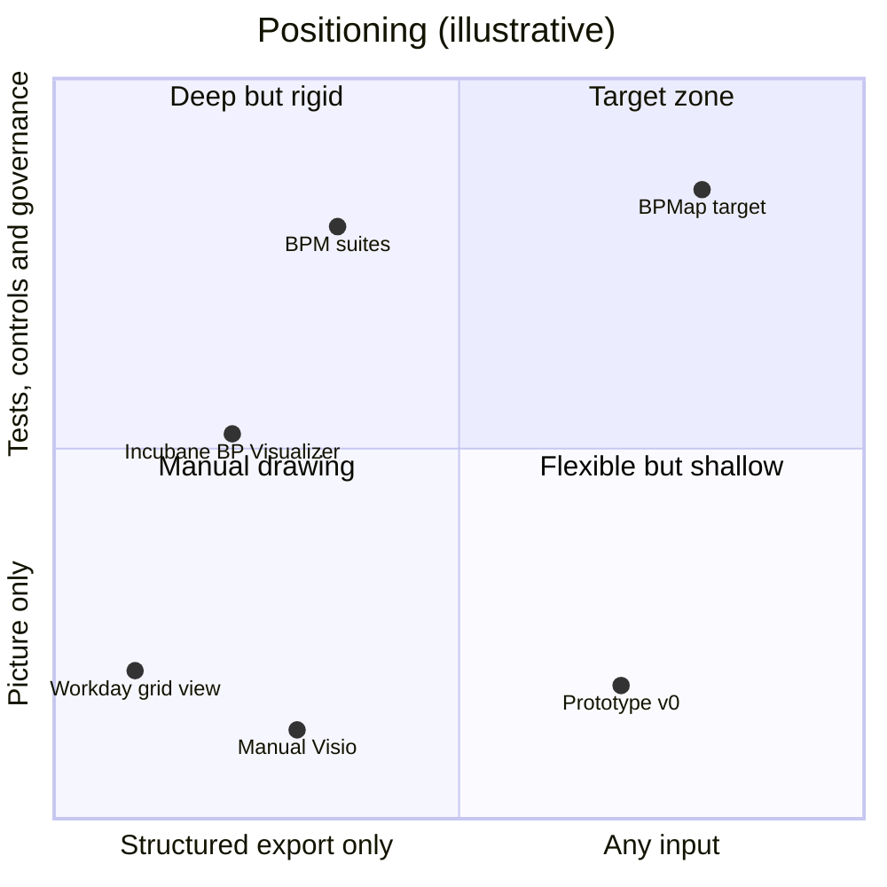
*Figure 1 — Competitive positioning (illustrative)*

### 3.3 Incubane BP Visualizer teardown (tested 10 Nov 2026)

Tested with the built-in *Change Job (Default Definition)* sample: 18 steps, 12 stages, 16 conditional, 9 security groups.

| Area | Observation | Implication for us |
|---|---|---|
| Input | Excel from *View Definition → Export*; uses the Steps and Notifications sheets; several files, one tab each; in-app "how to export" guide | Table stakes (IMP-01..05, IMP-11) |
| Privacy | "Nothing is uploaded"; only site, cookieless analytics and fonts on the network; state in `localStorage` | Table stakes; we should *prove* it (NFR-PRIV-01) |
| Notation | Columns = order letters; lanes = security groups; system lanes at bottom; **dashed border + C-badge for conditional steps**; condition list below; diamonds only on approvals; "No, skip"; exceptions explained once in the legend | Adopt and refine (VIS-01..06) |
| Views | Executive (stage cards), Process owner (swimlanes), Configurator (+ due, alternate, routing); Focus on a role | Adopt (VW-01..04, VIS-08) |
| Scenario | Yes / No / Not set per condition; skipped steps disappear; empty lanes collapse | Adopt, then extend with presets and test plans (SCN-*) |
| Health | 4 informational heuristics | Replace with a rule engine with severities (HLT-*) |
| Customise | Lane names, condition wording, notes, hide step, downstream systems; **overlay survives re-import** | Adopt; key overlays to stable IDs (CUS-*) |
| Export | PDF, editable PPTX, draw.io, PNG, SVG; **free account required** | Match the formats; keep basic formats free without an account (EXP-*) |
| Gaps | No condition logic, no security policy, no linked subprocesses, no compare found, no BPMN, no collaboration | Our differentiators (§8) |

## 4. Current-state assessment (prototype v0)

The prototype is a ~1,300-line React 19 + Vite + TypeScript app created in Google AI Studio. It uses React Flow for the canvas and Gemini 2.5 Flash for extraction.

<!-- figure: asis_tobe -->
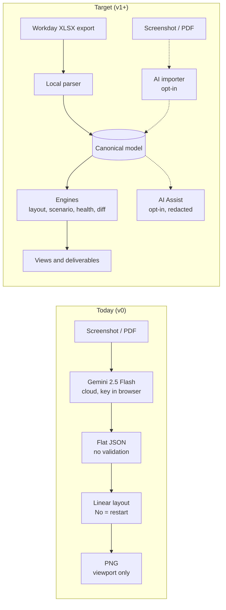
*Figure 2 — Current pipeline vs target pipeline*

**What to keep:** the extract → verify → regenerate loop, structured LLM output, React Flow, Tailwind, and screenshot input (as an opt-in fallback).

**What must change:** see the full issue register in Appendix A. The most severe items:

| ID | Issue | Severity |
|---|---|---|
| D1 | A false condition is drawn as "revert to initiation"; Workday skips the step | Critical |
| E1 | The Gemini API key is read in client code; it can't be kept secret | Critical |
| E2 | Tenant data is sent to a third-party LLM without consent | Critical |
| D2 | Order letters ignored; parallel steps drawn as serial | High |
| D3/D4 | Only 4 step types; approval nodes don't say who approves | High |
| E4 | PNG export captures only the visible viewport | High |
| E5 | Canvas and table are separate sources of truth; edits are lost on regenerate | High |

## 5. Goals, non-goals & success metrics

### 5.1 Goals

| # | Goal | Measure |
|---|---|---|
| G1 | Produce a **correct** diagram from any Workday BP export in under a minute | Median time from import to first render < 60 s; 100% fidelity on the fixture corpus |
| G2 | **Keep tenant data private by default** | 0 bytes of file content leave the browser in default mode (automated test) |
| G3 | Serve **three audiences** from one model | ≥ 50% of exports use a non-default view |
| G4 | Go **beyond the diagram** (tests, controls, compare) | ≥ 25% of Pro users generate a test plan or controls matrix monthly |
| G5 | Build a **sustainable business** | 40 paying teams within 12 months of Phase 2 |

### 5.2 Non-goals (v1)

- Editing or deploying BP definitions back into Workday (read-only only).
- Process mining from transaction logs.
- Building a general-purpose diagram editor.
- Mobile editing (tablet is read-only).
- Supporting non-Workday HCM/ERP process formats.

### 5.3 Success metrics

| Type | Metric | Target |
|---|---|---|
| North star | **Definitions delivered**: weekly exports + shares + test plans | 1,500 / week by month 12 |
| Activation | % of new users who import a file and export within the first session | ≥ 30% |
| Quality | Parse fidelity on the golden corpus | 100% (release gate) |
| Quality | User-reported diagram errors per 100 imports | < 1 |
| Engagement | Weekly active users (WAU) / monthly active users (MAU) | ≥ 35% |
| Monetisation | Free → Pro conversion | 3–5% |
| Trust | Security reviews passed without blocking findings | 100% |
| Satisfaction | NPS from design partners | ≥ 40 |

## 6. Users & personas

| Persona | Role | Primary jobs | Key features | Tier |
|---|---|---|---|---|
| **Priya — HRIS Analyst** | Customer systems team | Document as-is BPs; impact analysis before changes; release regression | Import, Configurator view, Compare, Health, Test plan | Free → Team |
| **Marco — Workday Consultant** | Partner / independent | Design workshops, deliverables, handover packs | Packs, branded PPTX/PDF, Customise, Scenarios | Pro |
| **Dana — Process Owner** | HR / Finance business lead | Understand and approve the process design | Process-owner view, plain-English conditions, SOP | Free (viewer) |
| **Sam — Executive sponsor** | VP HR / CFO office | One-slide overview; cycle-time hotspots | Executive view | Free (viewer) |
| **Alex — Internal Auditor** | SOX / controls | Evidence of approvals and segregation of duties | Controls matrix, SoD rules, security policy import | Team / Enterprise |
| **Jo — Test Lead** | Release / QA | Test every condition path after each Workday release | Scenario presets, test-plan generator, Compare | Pro / Team |

## 7. User journeys & key workflows

### 7.1 End-to-end workflow

<!-- figure: journey -->
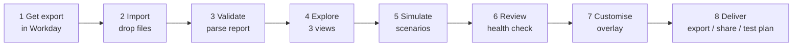
*Figure 3 — End-to-end user workflow (AI Assist optional at steps 3, 5, 6, 7 and 8)*

### 7.2 Key user stories

| ID | As a… | I want to… | So that… | Priority |
|---|---|---|---|---|
| US-01 | HRIS analyst | drop the Change Job export and see a correct swimlane in under a minute | I can explain the process in a meeting today | P0 |
| US-02 | Consultant | switch between Executive, Process owner and Configurator views | each audience sees the right level of detail | P1 |
| US-03 | Process owner | answer "promotion? works-council country?" and see only the steps that run | I understand the real path for a case | P1 |
| US-04 | Test lead | generate test cases for every meaningful condition combination | regression after a Workday release covers every path | P2 |
| US-05 | Auditor | see where an initiator could approve their own transaction | I can evidence segregation of duties | P2 |
| US-06 | Analyst | compare the Sandbox and Production definitions | I know exactly what will change at go-live | P2 |
| US-07 | Consultant | rewrite conditions in plain words and keep them after re-import | my customisations aren't lost each iteration | P1 |
| US-08 | Consultant | export an editable PowerPoint with my client's branding | I can drop it straight into the deliverable | P1 / P2 |
| US-09 | Analyst | open the Propose Compensation subprocess from the step that calls it | I can follow the whole end-to-end process | P2 |
| US-10 | Executive | get a one-slide view of stages and owners | I understand the process in a minute | P1 |
| US-11 | Security reviewer | verify the tool sends no tenant data by default | I can approve it for use | P0 |
| US-12 | Analyst with only a screenshot | still produce a draft diagram, with consent | I'm not blocked when I can't export | P2 |

## 8. Functional requirements

Priority key: **P0** = MVP (Phase 1) · **P1** = parity (Phase 2) · **P2** = differentiation (Phase 3) · **P3** = team/enterprise (Phase 4).

### 8.1 Import (IMP)

<!-- figure: import -->
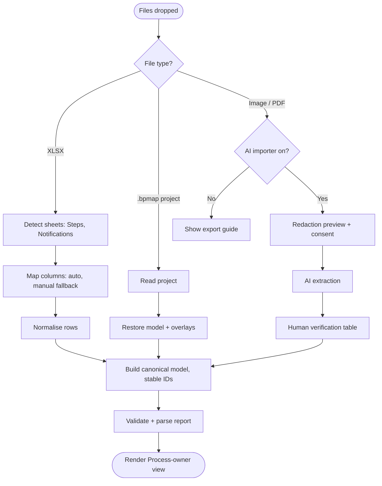
*Figure 4 — Import and parsing pipeline*

| ID | Requirement | Priority | Acceptance criteria |
|---|---|---|---|
| IMP-01 | Import the Workday *View Definition* Excel export (.xlsx) by drag-and-drop or file picker, parsed entirely in the browser (in a Web Worker) | P0 | Golden files for Change Job, Hire, Terminate, Create Journal and Create Supplier Invoice parse with 100% step fidelity; an automated test confirms no network request carries file content |
| IMP-02 | Detect the Steps and Notifications sheets by header signature (not sheet name or position); ignore other sheets with an info note | P0 | Works on all fixtures, including renamed and reordered sheets |
| IMP-03 | Map columns automatically, with a manual mapping dialog as fallback and saved mapping profiles | P0 | An unknown layout opens the dialog; a saved profile is reused silently on the next import |
| IMP-04 | Multi-file import: a definition plus subprocess definitions plus a notifications export, grouped into one project | P1 | Up to 20 files; subprocesses auto-linked to the calling step by task name; unmatched files listed |
| IMP-05 | Show a parse report after every import: rows read, steps built, conditions, unknown types, warnings with row references | P0 | Report is reachable from the toolbar; warnings link to rows |
| IMP-06 | Re-import a newer export of the same definition; keep overlays and flag changes | P1 | Overlays on steps with an unchanged stable key are preserved 100%; orphaned overlays listed for review |
| IMP-07 | Save and load the project file (`.bpmap.json`) with schema version and migrations | P0 | Files from older schema versions load after migration; round-trip is lossless |
| IMP-08 | Opt-in AI vision importer for screenshots and PDFs; output always goes through the verification table | P2 | Off by default; redaction preview shown before sending; verification required before render |
| IMP-09 | Import the condition-rule report to attach the real rule logic to each C-number | P2 | Logic shown in the Step and Scenario panels; *report format to be validated with design partners* |
| IMP-10 | Import the BP security policy: who may initiate, approve, cancel, rescind or correct | P2 | Allowed groups shown on the Step panel and used by SoD rules |
| IMP-11 | In-app "How to get the export" guide (3 steps, with screenshots) | P0 | Linked from the empty state and from import errors |

### 8.2 Process model & Workday semantics (MOD)

| ID | Requirement | Priority | Acceptance criteria |
|---|---|---|---|
| MOD-01 | Canonical model (§11.3), validated with zod and versioned | P0 | All importers produce it; invalid data never reaches the renderer |
| MOD-02 | Stable step IDs: `{order}-{kind}-{slug(task)}` plus a collision suffix; never the array index | P0 | The same export always produces the same IDs; IDs survive row re-ordering |
| MOD-03 | **Order semantics:** letters run in sequence; steps with the same letter run in parallel; suffixed orders (e.g. `f1`) are their own stage between `f` and `g` | P0 | Fixture with 6 parallel steps renders as one stage |
| MOD-04 | **Condition semantics:** a step runs only if all its entry conditions are true; false means **skip**, never "return to initiation" | P0 | No "revert" edges anywhere; "No, skip" label on decisions |
| MOD-05 | Step-kind catalogue: initiation, approval, approval chain, consolidated approval chain, action, to do, review, checklist, questionnaire, integration, service, sub-process; unknown types kept and flagged | P0 | Each kind has a distinct shape or label; unknown types appear in the parse report |
| MOD-06 | Steps with several groups (e.g. Payroll Interface Partner + Payroll Partner) and "all must act" | P0 | Primary lane plus an "Also:" list; the "all must act" badge is visible |
| MOD-07 | Configurator attributes: completion step, due date (relative / effective-date), alternate, routing, restriction, run-as | P1 | Shown in Configurator view and the Step panel |
| MOD-08 | Workday-owned vs customer-owned flag on each condition | P0 | Shown in the condition list; used by health rule HC-07 |
| MOD-09 | Notifications attached to the process and to steps | P1 | Listed in Configurator view and the Step panel |

### 8.3 Visualisation & notation (VIS)

| ID | Requirement | Priority | Acceptance criteria |
|---|---|---|---|
| VIS-01 | Swimlane layout: **columns = order stages, lanes = security groups** (order of first appearance); Workday-service and integration lanes at the bottom | P0 | Matches the notation in §9 |
| VIS-02 | Parallel split and join bars, with an "N in parallel" column header | P0 | Present wherever a stage has more than one step |
| VIS-03 | Conditional steps drawn with a dashed outline and C-badge, plus a numbered condition list under the diagram; diamonds only on approvals or when toggled | P0 | No diamond per condition by default |
| VIS-04 | Exceptions (send back, deny, cancel, rescind, correct) explained once in the legend, not drawn as arrows | P0 | Legend text included in every export |
| VIS-05 | Automatic layout (ELK.js) with no overlapping nodes or edges through nodes, for definitions up to 80 steps | P0 | Visual regression tests on the corpus |
| VIS-06 | A legend that is always present and included in exports | P0 | — |
| VIS-07 | Zoom, fit, full screen, minimap, hide panel | P0 | — |
| VIS-08 | Focus on one role: dim every other lane | P1 | — |
| VIS-09 | Collapse empty lanes and stages when a scenario hides steps | P1 | — |
| VIS-10 | Accessible colours (WCAG 2.2 AA); meaning never carried by colour alone | P0 | Automated contrast check; shape plus text for every state |
| VIS-11 | Manual layout nudges, stored in the overlay | P1 | Survive re-import for unchanged steps |

### 8.4 Audience views (VW)

| ID | Requirement | Priority | Acceptance criteria |
|---|---|---|---|
| VW-01 | **Executive:** one card per stage, parallel steps grouped, "only if" tags; fits one 16:9 slide for up to 15 stages | P1 | Rendered PPTX slide passes visual review |
| VW-02 | **Process owner:** swimlane diagram with plain-language labels | P0 | Default view |
| VW-03 | **Configurator:** adds due date, alternate, routing, restriction, run-as, notifications and Workday task names | P1 | All MOD-07/09 fields visible |
| VW-04 | The chosen view is saved per definition and applied to exports | P1 | — |

### 8.5 Scenario simulation & test planning (SCN)

<!-- figure: scenario -->
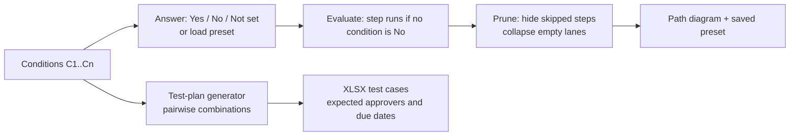
*Figure 5 — Scenario simulation and test-plan generation*

| ID | Requirement | Priority | Acceptance criteria |
|---|---|---|---|
| SCN-01 | Each condition can be set to Yes, No or Not set; skipped steps are hidden; the header shows the active scenario | P1 | Removing a step re-routes edges with no gaps |
| SCN-02 | Toggle to draw a condition as a yes/no decision diamond | P1 | — |
| SCN-03 | Named scenario presets (e.g. "Promotion – Netherlands") saved per definition and exportable | P1 | A preset can be applied to exports |
| SCN-04 | Compare two scenarios side by side | P2 | Differences highlighted |
| SCN-05 | **Test-plan generator:** pairwise combinations of the relevant conditions produce test cases with steps, expected approver groups and due dates; exported as XLSX | P2 | Every step is covered by at least one test case; combinatorial explosion is capped and reported |

### 8.6 Health check & controls (HLT, CTL)

| ID | Requirement | Priority | Acceptance criteria |
|---|---|---|---|
| HLT-01 | Rules engine (catalogue in §13) runs on every model change; findings grouped as Critical, Warning or Info | P1 (HC-01..06), P2 (rest) | Under 200 ms for 80 steps |
| HLT-02 | Each finding has an explanation, affected steps (click to highlight), a suggested fix, and "dismiss with reason" (stored in the overlay) | P1 | — |
| HLT-03 | Health score (0–100) per definition and per pack | P2 | Weighting documented |
| HLT-04 | Rule thresholds configurable per workspace | P3 | — |
| CTL-01 | Segregation-of-duties checks using the imported security policy | P2 | Initiator-can-approve paths flagged as Critical |
| CTL-02 | Controls matrix export (XLSX): control ID, BP, step, group, condition, evidence reference | P2 | Opens cleanly in Excel |
| CTL-03 | Map steps to client control IDs (stored in the overlay) | P2 | — |

### 8.7 Customisation (CUS)

| ID | Requirement | Priority | Acceptance criteria |
|---|---|---|---|
| CUS-01 | Overlay layer: lane renames, step labels, notes ("N" badge), hide step, plain-word condition text, downstream systems per step and on completion | P0 (labels, notes, hide) · P1 (rest) | The model itself is never changed by an overlay |
| CUS-02 | The overlay survives re-import (keyed on stable IDs) | P1 | See IMP-06 |
| CUS-03 | Save and load customisations as a separate file to share with colleagues | P1 | — |
| CUS-04 | Multi-level undo and redo (at least 50 steps) | P0 | Typing in a field counts as one undo step |
| CUS-05 | Branding templates: logo, colours and footer text for exports | P2 | Applied to PDF and PPTX |

### 8.8 Compare (CMP)

<!-- figure: diff -->
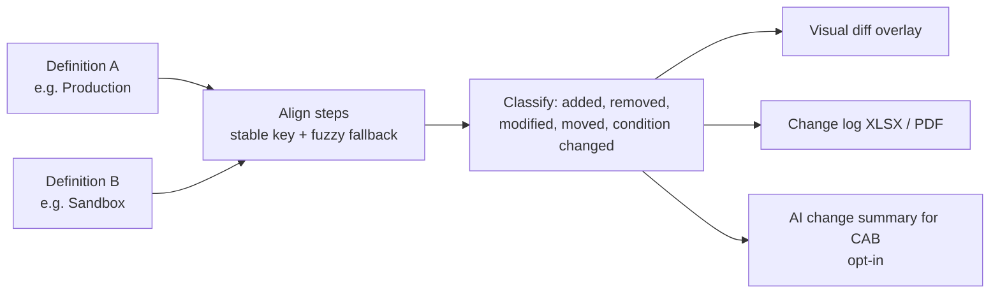
*Figure 6 — Compare (version vs version, tenant vs tenant)*

| ID | Requirement | Priority | Acceptance criteria |
|---|---|---|---|
| CMP-01 | Compare two definitions: two versions or two tenants | P2 | Matching precision ≥ 98% on the diff fixtures |
| CMP-02 | Visual diff overlay (added = green, removed = red, modified = blue; amber stays reserved for conditions, see Design System D-03) plus a change log table | P2 | Colours paired with icons and text |
| CMP-03 | Export the change log to XLSX or PDF | P2 | — |
| CMP-04 | AI change summary in business language (opt-in) | P2 | Every statement cites step IDs |

### 8.9 Packs & subprocesses (PCK)

| ID | Requirement | Priority | Acceptance criteria |
|---|---|---|---|
| PCK-01 | Group definitions into a pack (e.g. the Hire family) | P1 | Tabs per definition |
| PCK-02 | Drill down from a sub-process step into its definition and back (breadcrumb) | P2 | Works for nesting up to 3 levels deep |
| PCK-03 | Pack export: cover, contents, a section per definition, combined condition list and health summary | P1 | — |

### 8.10 Export (EXP)

| ID | Requirement | Priority | Acceptance criteria |
|---|---|---|---|
| EXP-01 | PNG and SVG of the **full** diagram (not the viewport), at 2× | P0 | Bounds computed from nodes |
| EXP-02 | Vector PDF: multi-page, A4/Letter/A3, legend and condition list included | P1 | Text selectable |
| EXP-03 | PPTX with **native editable shapes**: one slide per view plus a conditions slide | P1 | Every box and connector editable in PowerPoint |
| EXP-04 | draw.io XML (opens in diagrams.net; save-as-Visio path documented) | P1 | Lanes and containers preserved |
| EXP-05 | Mermaid | P2 | — |
| EXP-06 | BPMN 2.0 XML: lanes, parallel gateways, conditional flows | P2 | Opens in Camunda Modeler and Signavio |
| EXP-07 | Copy image to clipboard | P0 | — |
| EXP-08 | XLSX: steps, conditions, health findings, test plan | P1 / P2 | — |
| EXP-09 | Free tier exports PNG, SVG and PDF **without an account**; account needed for Pro formats | P1 | Pricing decision in §15 |

### 8.11 AI Assist (AI)

<!-- figure: ai_sequence -->
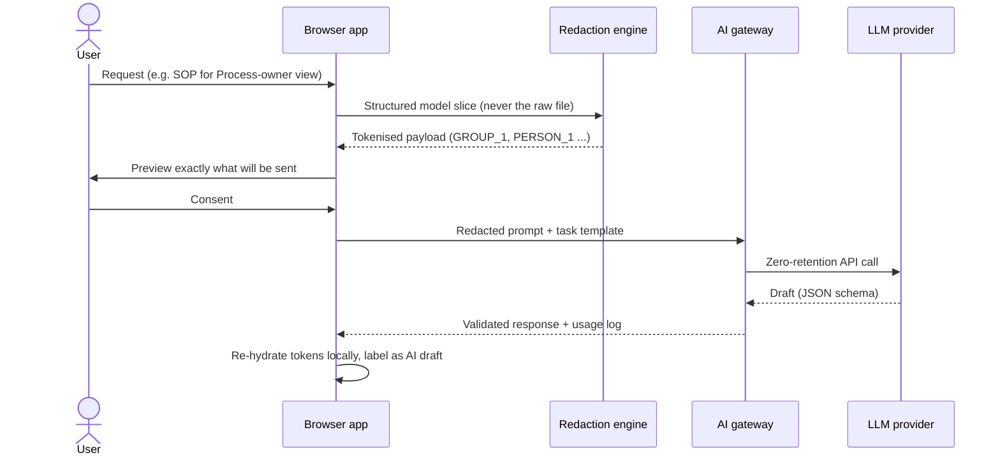
*Figure 7 — AI Assist data flow with redaction and consent*

| ID | Requirement | Priority | Acceptance criteria |
|---|---|---|---|
| AI-01 | Off by default; workspace-admin and user toggles; a persistent indicator while on | P2 | Default install makes no AI calls |
| AI-02 | Redaction and preview: security group names, people, IDs and custom condition text can be tokenised; the preview shows the exact payload | P2 | The payload in the preview is byte-identical to what is sent |
| AI-03 | Draft plain-English wording for conditions (uses rule logic if IMP-09 is loaded) | P2 | Accepted text goes into the overlay, never the model |
| AI-04 | SOP / narrative for each audience view | P2 | Exports to DOCX / PDF |
| AI-05 | Test-scenario narratives and expected results (adds to SCN-05) | P2 | — |
| AI-06 | Change summary for CAB from a diff (CMP-04) | P2 | Cites step IDs |
| AI-07 | "Ask the process": Q&A grounded only on the loaded model, with step citations | P2 | Refuses when the answer isn't in the model |
| AI-08 | Every AI output is labelled, editable, and never changes the model silently | P2 | — |
| AI-09 | Provider-agnostic gateway; zero-retention providers only; logs metadata only (no content) | P2 | Documented data-processing terms |
| AI-10 | Bring-your-own key (Pro); self-hosted model option (Enterprise) | P3 | — |

### 8.12 Collaboration & enterprise (COL, ENT)

| ID | Requirement | Priority | Acceptance criteria |
|---|---|---|---|
| COL-01 | Workspace library with version history per definition | P3 | Any version can be restored |
| COL-02 | Read-only share links with expiry and revocation | P3 | Viewers need no account |
| COL-03 | Comments and @mentions on steps | P3 | Email notifications |
| ENT-01 | SSO (SAML 2.0 / OIDC) and SCIM provisioning | P3 | Okta and Entra ID tested |
| ENT-02 | Roles: owner, editor, viewer | P3 | — |
| ENT-03 | Audit log of imports, exports, shares and AI calls | P3 | Exportable |
| ENT-04 | Data residency (EU / US) and a self-hosted container build | P3 | — |
| ENT-05 | Tenant connector: scheduled pull of BP definitions via a custom report (RaaS) | P3 | **Validate feasibility first** |

## 9. Diagram notation specification

The notation follows one principle: **show everything that changes the path, and explain everything else once.**

<!-- figure: notation -->
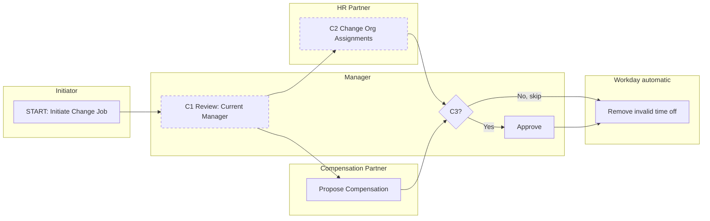
*Figure 8 — Notation reference: stages as columns, security groups as lanes*

| Element | Rendering | Rule |
|---|---|---|
| Stage | Column headed "Step a", "Step b"… and "· N in parallel" | One column per distinct order value |
| Lane | Horizontal band labelled with the security group | Ordered by first appearance; system lanes last |
| Initiation | Navy box with a "START" tag | Always the first stage |
| Approval / approval chain | Navy filled box | Label = task or "Approve", plus the group |
| Action / review | White box, solid outline | Label = Workday task |
| To do | Light-teal box | Label = to-do text |
| Workday service / integration | Grey box in the system lane | Label = service name |
| Conditional step | **Dashed amber outline + C-badge** | Condition text in the list under the diagram |
| Decision | Diamond "Cn?" with "Yes" and "No, skip" | Only on approvals by default, or when toggled |
| Parallel | Split and join bars | Wherever a stage has more than one step |
| Completion | Green check after the completion step | From the "complete" flag |
| Note | "N" badge | From the overlay |
| Exceptions | Legend text only | Send back, deny, cancel, rescind, correct |

## 10. Non-functional requirements

| ID | Category | Requirement |
|---|---|---|
| NFR-PRIV-01 | Privacy | In default mode no file content, model or derived data leaves the browser. Enforced by a Content-Security-Policy `connect-src` allowlist and an automated network-capture test in CI |
| NFR-PRIV-02 | Privacy | Analytics are cookieless and never contain content or file names |
| NFR-SEC-01 | Security | No secrets in the client bundle; CI scans `dist/` for key patterns |
| NFR-SEC-02 | Security | Strict CSP and Subresource Integrity (SRI); dependency scanning; XLSX parsed in a Web Worker with a 25 MB limit and zip-bomb guards |
| NFR-SEC-03 | Security | AI gateway: authentication, rate limiting, payload size limits, prompt-injection guards (model content is treated as data), zero-retention providers |
| NFR-PERF-01 | Performance | Parse and render a 60-step definition in < 2 s (P95) on a 2020-era laptop; 200 steps in < 5 s |
| NFR-PERF-02 | Performance | Single-definition PDF export in < 5 s; 10-definition pack in < 30 s |
| NFR-A11Y | Accessibility | WCAG 2.2 AA; keyboard navigation between steps; a screen-reader step list as an alternative to the canvas |
| NFR-COMP | Compatibility | Latest two versions of Chrome, Edge, Safari and Firefox; desktop first; tablet read-only |
| NFR-REL | Reliability | Autosave to IndexedDB on every change; recovery after a crash; nothing lost on refresh |
| NFR-I18N | Internationalisation | English UI at launch; parser tolerant of localised headers (EN, DE, FR, NL, ES) by Phase 3 |
| NFR-QUAL | Quality | Parser line coverage ≥ 90%; golden corpus ≥ 30 definitions by Phase 2 and ≥ 50 by Phase 3; visual regression tests on every PR |
| NFR-LEGAL | Legal | Nominative trademark use only, with the disclaimer on every page and export; no Workday logo |

## 11. Solution architecture

### 11.1 Logical architecture

<!-- figure: architecture -->
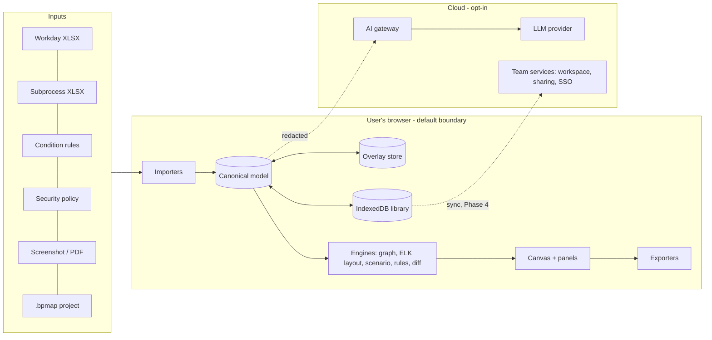
*Figure 9 — Logical architecture and trust boundaries*

### 11.2 Technology choices

| Layer | Choice | Rationale |
|---|---|---|
| App shell | React 19 + Vite + TypeScript (keep) | Already in place; fast; the team knows it |
| Canvas | React Flow `@xyflow/react` v12 (keep) | Mature; custom nodes; good performance |
| Layout | **ELK.js** (layered, with partitions for lanes) | Handles parallel branches, lanes and edge routing |
| State | **Zustand + zundo** | Simple store with multi-level undo |
| Validation | **zod** | Runtime safety for every importer and the AI output |
| XLSX | **exceljs** (or SheetJS from its official distribution) in a Web Worker | Reads in the browser; worker keeps the UI responsive |
| Storage | **Dexie (IndexedDB)** | Local library, autosave |
| Export | `pptxgenjs`, `jspdf` + `svg2pdf.js`, hand-built draw.io / BPMN XML | Native editable outputs |
| Tests | Vitest (unit, golden files), Playwright (E2E, network capture, visual regression) | Supports the quality gates |
| Backend (Phase 3+) | Small TypeScript service (e.g. Cloudflare Workers or Node) for the AI gateway; Postgres for team data (Phase 4) | Minimal surface area; can be self-hosted |
| AI | Provider-agnostic adapter; Claude or Gemini via zero-retention APIs; structured JSON outputs | Avoids lock-in; enterprise-acceptable |

### 11.3 Data model

<!-- figure: datamodel -->
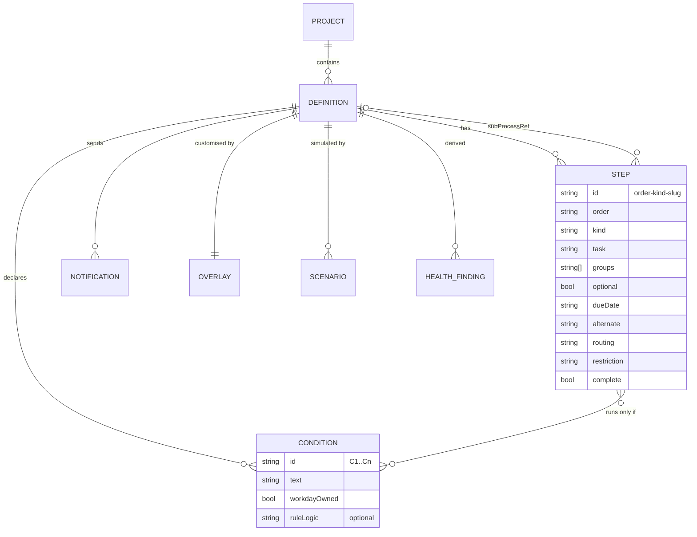
*Figure 10 — Canonical data model*

**Design rules**

1. **There is one source of truth: the canonical model.** The table, canvas and exports are all views of it.
2. **Overlays never change the model.** They are a separate layer keyed by stable IDs, so they survive re-import.
3. **Everything derived** (layout, health findings, diffs, test plans) is recomputed from the model and overlay, never stored as the source.

## 12. AI design principles & guardrails

| Principle | Implementation |
|---|---|
| **Opt-in, never default** | Workspace policy and user toggle; persistent indicator while on |
| **Structured in, structured out** | Prompts are built from model slices; outputs validated with JSON schemas and zod |
| **Minimum necessary data** | Only the fields the task needs; redaction tokens for names, groups and IDs |
| **Show before send** | The preview is the exact payload; consent is logged |
| **Human in the loop** | AI output is a labelled draft; accepting it writes to the overlay, never the model |
| **Grounded and cited** | Q&A and summaries cite step and condition IDs; refuse when the answer isn't in the model |
| **No training, no retention** | Zero-retention providers only; the gateway logs metadata only |
| **Evaluated** | Offline eval set per AI feature (wording, SOP, change summary); regression before every model upgrade |

## 13. Health-check rule catalogue

| ID | Rule | Severity | Data needed | Phase |
|---|---|---|---|---|
| HC-01 | Approval step not restricted from the initiator (self-approval risk) | Critical | Restriction field (or security policy) | 2 |
| HC-02 | Required approval or action with no alternate | Warning | Alternate | 2 |
| HC-03 | Approval or action with no due date | Info | Due date | 2 |
| HC-04 | Same group acts in consecutive serial stages (could run in parallel) | Info | Order, groups | 2 |
| HC-05 | Group receives three or more tasks in one stage (consider a checklist or consolidated step) | Info | Order, groups | 2 |
| HC-06 | Serial approval chain longer than N (default 4) | Warning | Order, kinds | 2 |
| HC-07 | Customer-owned conditions to re-validate after each Workday release | Info | workdayOwned | 2 |
| HC-08 | Approval placed after the completion step | Warning | Complete flag | 3 |
| HC-09 | Called subprocess not loaded | Info | Sub-process refs | 3 |
| HC-10 | Unknown or unsupported step type | Warning | Kind | 3 |
| HC-11 | Duplicate step (same task and group in the same stage) | Warning | Task, group, order | 3 |
| HC-12 | Optional approval on a Financials BP (control may be skipped) | Warning | Optional, BP family | 3 |
| HC-13 | Initiating group can also cancel, rescind or correct (SoD) | Critical | Security policy (IMP-10) | 3 |
| HC-14 | No completion notification to the initiator | Info | Notifications | 3 |
| HC-15 | Condition referenced on many steps with diverging plain-word overrides | Info | Overlay | 3 |
| HC-16 | Step can never run: its condition is constant-false (e.g. `1=0?`, a common way to switch a step off). Found in a real export. **Built in Increment 1.1** | Warning | Condition text | 1 |

## 14. Release plan & roadmap

<!-- figure: roadmap -->
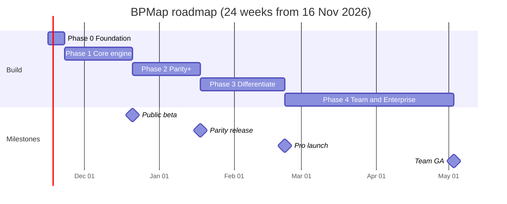
*Figure 11 — Roadmap and milestones*

| Phase | Weeks | Scope (requirement IDs) | Exit criteria |
|---|---|---|---|
| **0. Foundation** | 1 | Install toolchain, git, CI; fix E1/E3/E4/E6/E10/E11; remove the client-side key; rebrand | `lint`, `test` and `build` pass; secret scan clean; no Workday logo |
| **1. Core engine** → *Public beta* | 2–5 | IMP-01/02/03/05/07/11 · MOD-01..06/08 · VIS-01..07/10 · VW-02 · CUS-01 (part)/04 · EXP-01/07 | 20+ anonymised definitions at 100% fidelity; network test green; 10 beta users |
| **2. Parity+** → *Parity release* | 6–9 | IMP-04/06 · MOD-07/09 · VIS-08/09/11 · VW-01/03/04 · SCN-01..03 · HLT-01/02 (HC-01..07) · CUS-01..03 · PCK-01/03 · EXP-02/03/04/08/09 | 5 design partners use it on live work; editable PPTX validated |
| **3. Differentiate** → *Pro launch* | 10–14 | IMP-08/09/10 · SCN-04/05 · HLT-03 · CTL-01..03 · CUS-05 · CMP-01..04 · PCK-02 · EXP-05/06 · AI-01..09 | Test plans used weekly by ≥ 3 partners; first paid conversions; AI eval thresholds met |
| **4. Team & Enterprise** → *Team GA* | 15–24 | COL-01..03 · ENT-01..04 · AI-10 · HLT-04 · ENT-05 pilot | First 10 paying teams; one security review passed |

## 15. Pricing & packaging (proposed)

| Tier | Price (indicative) | Includes |
|---|---|---|
| **Free** | $0, no account for core use | Local import, 3 views, scenarios, health (Info + Warning), PNG/SVG/PDF export, single definition |
| **Pro** | $19–25 per user / month | Packs, compare, PPTX / draw.io / BPMN / XLSX exports, full health and controls, test-plan generator, branding, AI Assist (fair use), BYO key |
| **Team** | $49 per user / month (min. 5) | Shared library, versioning, share links, comments, workspace AI policy, priority support |
| **Enterprise** | Custom | SSO/SCIM, audit log, data residency, self-hosted build, tenant connector, DPA, SLA |

**Partner programme:** discounted Pro licences plus white-label exports for Workday implementation partners.

## 16. Go-to-market

1. **Design partners (weeks 1–9).** Recruit 5–10 HRIS leads and consultants, for example people who engaged with the Nov 2026 LinkedIn launch. Exchange early access for anonymised exports, which become the golden corpus.
2. **Build in public.** Weekly LinkedIn clips, one differentiator each, e.g. "14 test cases for Change Job in 10 seconds".
3. **Trust kit.** One-page security note, a network-capture video showing that nothing is uploaded, and a DPA template.
4. **Community.** Workday Community groups, regional user groups and Workday Rising side events; explore a partner or marketplace listing.
5. **Partner channel.** White-label licences for boutique Workday partners.
6. **Content SEO.** "How to read a Workday Change Job definition" and similar guides, with the tool embedded.

## 17. Analytics & instrumentation

| Event | Properties (no content, no file names) | Used for |
|---|---|---|
| `import_completed` | steps_count, stages_count, conditions_count, warnings_count, duration_ms, source_type | Activation, quality |
| `parse_warning` | warning_code | Parser roadmap |
| `view_changed` | view | G3 |
| `scenario_applied` | conditions_set_count | Engagement |
| `health_viewed` / `finding_dismissed` | rule_id, severity | Rule tuning |
| `export_completed` | format, view, pages | North star |
| `test_plan_generated` | cases_count | G4 |
| `ai_request` | feature, tokens, latency, accepted | AI value and cost |

## 18. Risks & mitigations

| Risk | Likelihood | Impact | Mitigation |
|---|---|---|---|
| Export format varies by tenant, release or locale | High | High | Golden corpus from partners; header-signature detection; mapping UI; telemetry on warning codes |
| Security objections to any cloud use | High | High | Local-first default; AI opt-in with redaction preview; self-hosting; trust kit |
| Free competitor improves quickly | Medium | Medium | Compete on test plans, controls, compare, BPMN and collaboration rather than the diagram |
| Trademark complaint | Low | High | Rename; nominative use; disclaimer; no logo |
| AI output is wrong or misleading | Medium | Medium | Grounding, citations, labelled drafts, eval sets, never writes to the model |
| Scope creep for a small team | High | Medium | Strict phase exit criteria; public beta before Phase 3 |
| Condition-rule and security-policy exports unavailable or inconsistent | Medium | Medium | Validate with partners before committing; treat as enrichment, not a dependency |

## 19. Open questions & assumptions

| # | Question / assumption | Owner | Due |
|---|---|---|---|
| Q1 | How much do the export columns vary across releases and locales? Need ≥ 20 samples | Product | Phase 1, week 2 |
| Q2 | Can the condition-rule logic and the BP security policy be exported in a consistent format? | Product + partners | Phase 2 |
| Q3 | Should basic downloads need an account (lead capture vs. friction)? Proposed: no | Product | Phase 2 |
| Q4 | Final product name and domain; trademark search | Founder | Phase 0 |
| Q5 | AI provider and region strategy (EU / US) | Engineering | Phase 3 |
| Q6 | Is a Workday partner or marketplace listing feasible and worthwhile? | Founder | Phase 3 |
| Q7 | Is RaaS-based tenant sync feasible and acceptable to security teams? | Engineering + partner | Phase 4 |
| A1 | *Assumption:* the *View Definition* Excel export is available to the target users | — | Validate with partners |
| A2 | *Assumption:* Workday-delivered default definitions are suitable non-sensitive test fixtures | — | Validate |

## Appendix A — Prototype issue register

| ID | Area | Issue | Location | Fix (phase) |
|---|---|---|---|---|
| D1 | Semantics | False condition drawn as "revert to initiation" | `FlowchartEditor.tsx:137-157, 501-503` | MOD-04 · Phase 0 hot-fix, Phase 1 |
| D2 | Semantics | Order letters ignored; no parallel steps | `FlowchartEditor.tsx:82-206` | MOD-03 · Phase 1 |
| D3 | Semantics | Only 4 step types mapped | `FlowchartEditor.tsx:89-96` | MOD-05 · Phase 1 |
| D4 | Semantics | Non-action nodes show the type name, not the task or group | `FlowchartEditor.tsx:165` | VIS-01 · Phase 1 |
| D5 | Layout | Unknown group placed at y=100, overlapping lane 0 | `FlowchartEditor.tsx:86-87` | VIS-05 · Phase 1 |
| D6 | Model | No validations, notifications, sub-process or routing | `types.ts` | MOD-01 · Phase 1 |
| E1 | Security | API key read in client code | `gemini.ts:4`, `vite.config.ts` | Phase 0 |
| E2 | Privacy | Tenant data sent to an LLM without consent | `gemini.ts` | Phase 0 (disable) · AI-01/02 in Phase 3 |
| E3 | Build | "Add Row" omits required fields (likely TS error); fields not editable | `DataVerification.tsx:20-35` | Phase 0 |
| E4 | Export | PNG captures the viewport only | `FlowchartEditor.tsx:342-371` | EXP-01 · Phase 1 |
| E5 | State | Canvas and table are separate sources of truth | `FlowchartEditor.tsx:211-235` | MOD-01, CUS-01 |
| E6 | State | One-level undo; state mutated in place | `FlowchartEditor.tsx:219-229, 308, 321` | CUS-04 |
| E7 | Robustness | LLM output not validated at runtime | `gemini.ts:86` | MOD-01 |
| E8 | UX | PDF upload previewed with ``; single file only | `UploadSection.tsx:29`, `App.tsx:234` | IMP-04 |
| E9 | Persistence | No save/load; refresh loses work | — | IMP-07, NFR-REL |
| E10 | Legal | Product name and hotlinked Workday logo | `App.tsx:156-165` | Phase 0 |
| E11 | Hygiene | No git, no tests, unused dependencies, AI Studio leftovers | — | Phase 0 |
| E12 | Accessibility | Colour-only meaning; no keyboard editing | `CustomNodes.tsx` | VIS-10, NFR-A11Y |

## Appendix B — Glossary

| Term | Meaning |
|---|---|
| **BP / business process** | A Workday workflow (e.g. Hire, Change Job, Create Journal) |
| **BP definition** | The configured steps of a BP type; there may be a default definition and organisation-specific ones |
| **Order** | The letter (a, b, c…) that sequences steps; the same letter means the steps run in parallel |
| **Entry condition** | A rule on a step; if false the step is skipped |
| **Security group** | The group of users who receive a step (the swimlane) |
| **Subprocess** | A BP that runs as a step of another BP (e.g. Propose Compensation inside Hire) |
| **Send back / deny / cancel / rescind / correct** | Exception actions on an in-flight or completed BP, governed by the BP security policy |
| **Overlay** | User customisations stored separately from the imported model |
| **SoD** | Segregation of duties: the same person should not initiate and approve |
| **RaaS** | Report-as-a-Service: a Workday custom report exposed as a web service |
| **CAB** | Change Advisory Board |

---
*End of document.*
